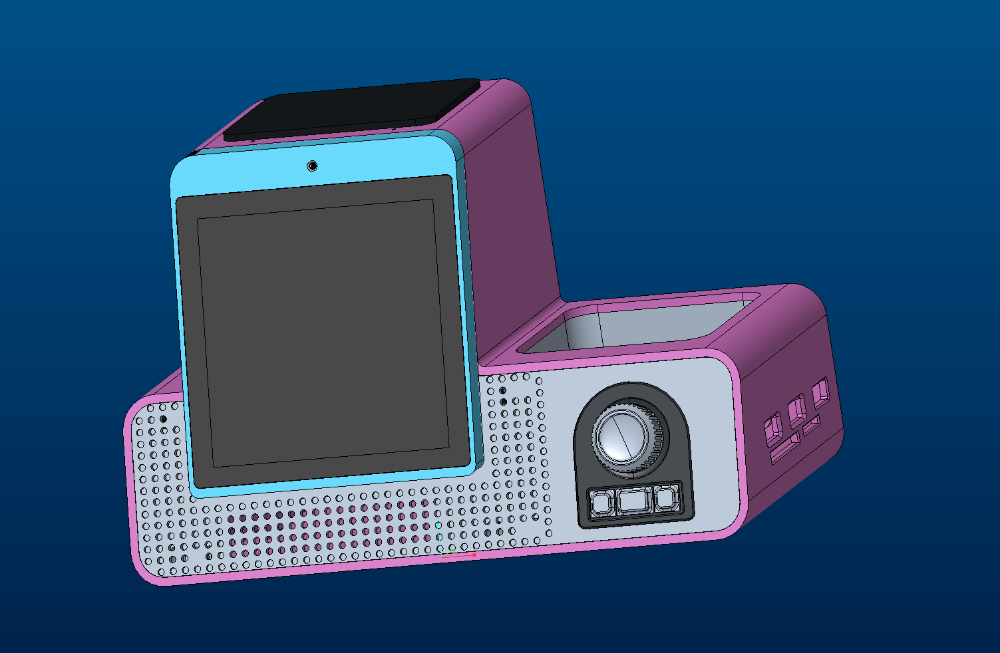
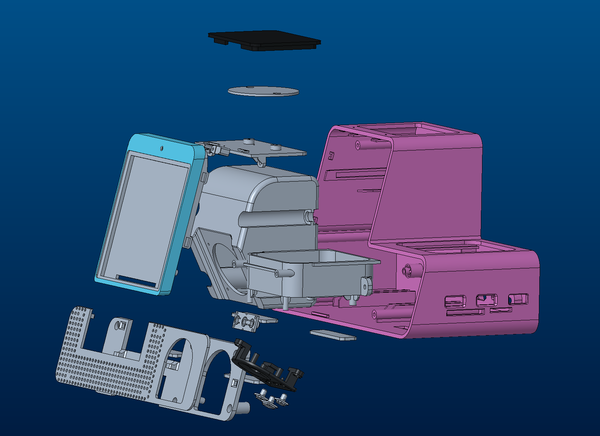

# BinBot 机械结构设计（MD）

本目录收录从 Creo Parametric 导出的 STEP AP214 结构模型，长度单位为毫米（mm）。
当前共 23 个 STEP 文件，包含 6 个装配文件和 17 个零件文件。

## 整机装配



## 分解视图



分解视图展示外壳、屏幕、内部支架、模块插槽及前部控制区等部件的相对位置。
两张截图用于展示整机布局；当前 STEP 资料以结构件及支架为主，未包含屏幕、
摄像头、喇叭本体、无线充电线圈和紧固件模型。

## 目录与打开方法

```text
MD/
├── README.md              模型索引与打开说明
├── SHA256SUMS             23 个 STEP 文件的校验值
├── images/                整机装配与分解视图
└── step/                  整机、子装配与零件，保留原始导出文件名
```

下载整个 `step/` 目录，在支持 STEP AP214 外部引用的 CAD 软件中打开
[`binbot_master_asm_top.stp`](step/binbot_master_asm_top.stp)。导入时启用外部引用
或多文件装配加载，并将引用搜索目录设置为同一个 `step/` 目录。

这批文件采用多文件装配：总装和子装配通过文件名引用其他模型。只下载总装文件，
或者单独改名、移动零件，会导致缺件。查看单个零件时可以直接打开对应 STEP。
如果软件未加载完整装配，应先检查它对 AP214 外部引用的支持情况。

在 `MD/` 目录中可校验文件：

```sh
sha256sum -c SHA256SUMS
```

## 装配入口

| 文件 | 内容 | 直接引用的不同文件数 |
| --- | --- | --- |
| [binbot_master_asm_top.stp](step/binbot_master_asm_top.stp) | 结构总装，包含壳体装配与其余结构子装配 | 2 |
| [binbot_ee_system_asm.stp](step/binbot_ee_system_asm.stp) | 垫片与扬声器结构单元的装配布局 | 3 |
| [binbot_shell_asm_asm.stp](step/binbot_shell_asm_asm.stp) | 外壳、支架、控制区等结构装配 | 10 |
| [soundhole_shell_as_asm.stp](step/soundhole_shell_as_asm.stp) | 前部控制区子装配，含控制板相关件、按键、旋钮与固定件 | 5 |
| [speaker_unit_asm_asm.stp](step/speaker_unit_asm_asm.stp) | 扬声器结构单元装配入口 | 1 |
| [speaker_asm_asm.stp](step/speaker_asm_asm.stp) | 扬声器子装配，当前仅引用壳体 | 1 |

表中统计的是不同文件数，同一个零件可以在装配中出现多次；这不是采购数量表。
`binbot_ee_system_asm.stp` 为机械子装配，不包含电子原理图或 PCB 设计。

## 结构零件

| 文件 | 说明 |
| --- | --- |
| [front_cover_prt.stp](step/front_cover_prt.stp) | 前盖 |
| [rear_cover_prt.stp](step/rear_cover_prt.stp) | 后盖 |
| [top_wireless_charge_prt.stp](step/top_wireless_charge_prt.stp) | 顶部无线充电区域结构件 |
| [acousti_fix_cover_prt.stp](step/acousti_fix_cover_prt.stp) | 声学区域固定盖 |
| [acoutsti_cover_prt.stp](step/acoutsti_cover_prt.stp) | 声学区域盖板，保留原始导出拼写 |
| [camera_fix_prt.stp](step/camera_fix_prt.stp) | 摄像头固定件 |
| [module_slot_prt.stp](step/module_slot_prt.stp) | 扩展模块插槽结构件 |
| [wireless_charge_pcba_fix_prt.stp](step/wireless_charge_pcba_fix_prt.stp) | 无线充电板固定件 |
| [wireless_charge_coil_fix_prt.stp](step/wireless_charge_coil_fix_prt.stp) | 无线充电线圈固定件 |
| [front_ctrl_board_part__prt.stp](step/front_ctrl_board_part__prt.stp) | 前部控制板相关结构件 |
| [front_ctrl_key_big__prt.stp](step/front_ctrl_key_big__prt.stp) | 前部大按键 |
| [front_ctrl_key_small__prt.stp](step/front_ctrl_key_small__prt.stp) | 前部小按键 |
| [front_ctrl_knob__prt.stp](step/front_ctrl_knob__prt.stp) | 前部旋钮 |
| [key_fix_prt.stp](step/key_fix_prt.stp) | 按键固定件 |
| [speaker_shell_prt.stp](step/speaker_shell_prt.stp) | 扬声器壳体 |

## 垫片

| 文件 | 说明 |
| --- | --- |
| [rubber_pad_44_12_2_prt.stp](step/rubber_pad_44_12_2_prt.stp) | 橡胶垫片 |
| [rubber_mat_prt.stp](step/rubber_mat_prt.stp) | 橡胶垫占位模型，当前导出仅有定位信息，没有实体几何 |

## 整理检查

23 个 STEP 文件均保留本批导出的原始字节内容；总装及子装配引用的文件齐全，全部模型均可
从总装入口沿引用关系找到。已检查 STEP 文件结束标记、文件内实体引用和文件间
装配引用，尚未在 CAD 软件中完成整机导入及几何验收。

本批为 STEP 交换模型；Creo 原生工程、二维工程图和制造工艺资料后续补充。
